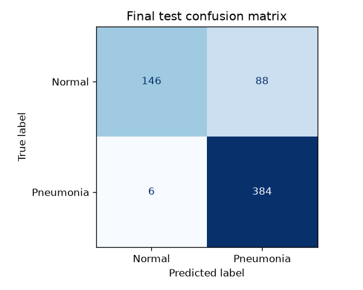
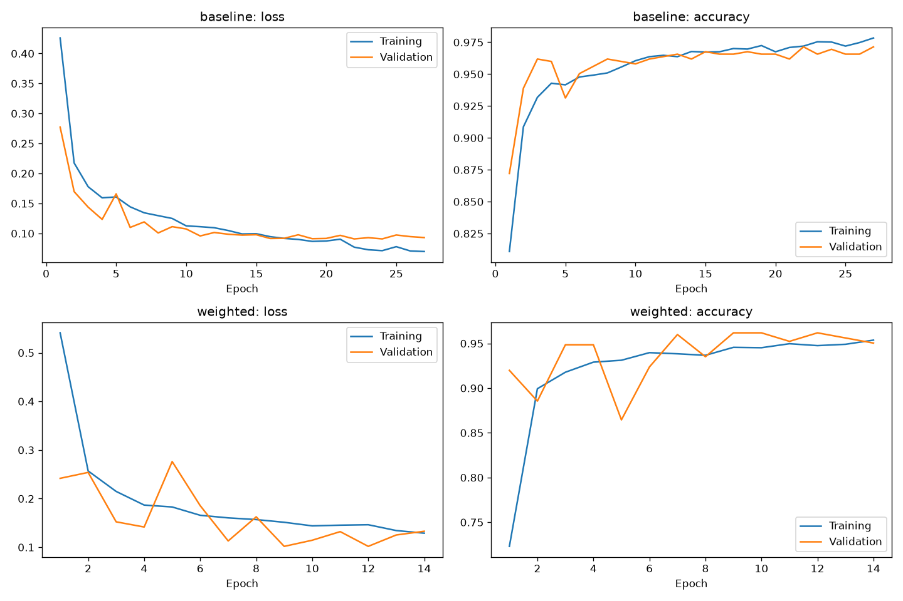

# Chest X-ray classification with PneumoniaMNIST

A beginner CNN project that classifies small grayscale chest X-rays as **Normal (0)** or **Pneumonia (1)**. The main notebook, [`pnuemo.ipynb`](pnuemo.ipynb), contains the complete workflow, executed outputs, and visualizations. The repository also includes the dataset, extracted arrays, trained model, and evaluation artifacts.

**Main finding:** the selected CNN detected 384 of 390 pneumonia-labelled test images, but incorrectly flagged 88 of 234 normal-labelled images. High sensitivity came with relatively low specificity. This is an educational benchmark, not a clinically validated diagnostic system.

## What was done

1. Set up Python 3.12 with TensorFlow/Keras in VS Code and Jupyter.
2. Loaded `pneumoniamnist.npz` and inspected its original training, validation, and test splits.
3. Extracted the six `.npy` arrays into the project folder and verified that they match the archive.
4. Checked image/label counts, missing values, and label validity. Every one of the 5,856 images had one valid label.
5. Counted both classes and displayed training images with their labels.
6. Converted pixels from 0–255 to 0–1 and added the grayscale channel dimension: `(N, 28, 28, 1)`.
7. Trained a baseline CNN and a class-weighted CNN. Weights were calculated from training labels only.
8. Selected the model using validation balanced accuracy, with validation ROC-AUC as the tie-breaker.
9. Evaluated the selected model on the test split at a fixed threshold of 0.5.
10. Reviewed learning curves, the confusion matrix, and misclassified images. Reloaded the saved model and confirmed that it reproduces the stored test predictions.

## Dataset and classes

Images are grayscale and **28 × 28 pixels**. Resizing them upward does not restore the original X-ray detail.

| Split | Normal (0) | Pneumonia (1) | Total |
|---|---:|---:|---:|
| Training | 1,214 | 3,494 | 4,708 |
| Validation | 135 | 389 | 524 |
| Test | 234 | 390 | 624 |
| All splits | 1,583 | 4,273 | 5,856 |

Normal images account for 27% of the full dataset; pneumonia-labelled images account for 73%. The original splits are preserved. An image at index `i` corresponds to the label at index `i` in the same split.

Dataset source: [MedMNIST](https://medmnist.com/), with [official PneumoniaMNIST metadata](https://github.com/MedMNIST/MedMNIST/blob/main/medmnist/info.py). The official metadata lists the dataset license as **CC BY 4.0**; retain attribution when redistributing it. This dataset license does not automatically license the project code.

## CNN and training settings

```text
Input (28, 28, 1)
  → Conv2D: 16 filters, 3×3, same padding, ReLU
  → MaxPooling2D: 2×2
  → Conv2D: 32 filters, 3×3, same padding, ReLU
  → MaxPooling2D: 2×2
  → Flatten
  → Dense: 32 units, ReLU
  → Dropout: 0.3
  → Dense: 1 unit, sigmoid
```

The model has **55,041 trainable parameters**. Both candidates used Adam at a learning rate of `0.001`, binary cross-entropy, a batch size of `32`, and seed `42`. Training data was shuffled. Early stopping monitored validation loss with patience `5`, a maximum of `30` epochs, and restoration of the best weights. No image augmentation was used in this experiment.

| Candidate | Epochs run | Best epoch | Validation balanced accuracy | Validation ROC-AUC |
|---|---:|---:|---:|---:|
| Baseline — selected | 27 | 22 | 96.14% | 0.9942 |
| Class-weighted | 14 | 9 | 95.01% | 0.9923 |

Class weights were approximately `1.9390` for Normal and `0.6737` for Pneumonia. They did not improve validation performance in this run. Weighted training loss and unweighted validation loss use different weighting, so their absolute values are not directly comparable.

## Final test results

Results below come from the selected baseline model and all **624 test images**, using a pneumonia-score threshold of **0.5**.

| Metric | Result |
|---|---:|
| Accuracy | 84.94% |
| Balanced accuracy | 80.43% |
| Sensitivity — pneumonia recall | 98.46% |
| Specificity — normal recall | 62.39% |
| ROC-AUC | 0.9432 |
| Correct / incorrect predictions | 530 / 94 |

| Actual class | Predicted Normal | Predicted Pneumonia |
|---|---:|---:|
| Normal | 146 | 88 |
| Pneumonia | 6 | 384 |

The model missed 6 pneumonia-labelled images and produced 88 false positives. Accuracy alone would obscure this tradeoff. Sigmoid outputs are model scores, not established clinical probabilities.





## Run the notebook

Use **Python 3.12** and the VS Code Python and Jupyter extensions. Run commands from this project's root folder so the relative dataset paths resolve correctly.

### Windows setup helper

```powershell
powershell -ExecutionPolicy Bypass -File .\setup_environment.ps1
```

This helper requires the Python install manager (`py install`), downloads Python 3.12 into `.python312`, creates `.venv312`, installs dependencies, and verifies imports. It checks for at least 3 GB of free space before installation.

### Manual setup with an installed Python 3.12

```powershell
py -3.12 -m venv .venv312
.\.venv312\Scripts\python.exe -m pip install -r requirements.txt
```

For macOS/Linux with Python 3.12 installed:

```bash
python3.12 -m venv .venv312
.venv312/bin/python -m pip install -r requirements.txt
```

Open `pnuemo.ipynb`, select the `.venv312` interpreter as the kernel, and run the cells from top to bottom. Running all cells **retrains both models and overwrites the generated results**. CPU training is sufficient for this small model; runtime depends on hardware.

The recorded environment used NumPy 1.26.4, TensorFlow 2.16.2, Keras 3.15.1, Matplotlib 3.11.2, scikit-learn 1.9.1, and ipykernel 6.31.0. `requirements.txt` fixes NumPy and TensorFlow and provides version ranges for the other main packages. Exact numerical reproduction can vary with dependency versions and hardware. Avoid unrelated package-install cells that upgrade NumPy to 2.x: TensorFlow 2.16.2 requires NumPy below 2.

### Test the saved model without retraining

Run the final notebook section, **“Test the saved model without retraining.”** It independently loads the model and the extracted test arrays, applies training-time preprocessing, prints metrics, and displays 16 examples. This repeats the original evaluation; it is not a new independent test.

To load the model in your own code:

```python
import numpy as np
from tensorflow import keras

model = keras.models.load_model("cnn_results/pneumonia_cnn.keras", compile=False)
images = np.load("test_images.npy", allow_pickle=False)
inputs = images[:4].astype("float32")[..., None] / 255.0
scores = model(inputs, training=False).numpy().reshape(-1)
predictions = (scores >= 0.5).astype("int32")  # 0 = Normal, 1 = Pneumonia
```

## File roadmap

| File | Purpose |
|---|---|
| `README.md` | Workflow, results, setup instructions, file map, and next steps. |
| `pnuemo.ipynb` | Main learning notebook: inspection, label checks, visualization, preprocessing, CNN training, evaluation, and saved-model testing. The original filename is retained. |
| `requirements.txt` | Python dependencies; pins NumPy 1.26.4 and TensorFlow 2.16.2. |
| `setup_environment.ps1` | Windows Python/environment setup and import verification. |
| `.run_cnn_notebook.py` | Optional execution helper. Runs all notebook code cells, captures outputs and plots, and writes them back to the notebook. Training code itself is in the notebook. |
| `.gitignore` | Excludes local environments, caches, temporary files, and development logs. |
| `.vscode/settings.json` | Default Windows interpreter path for this workspace; select the appropriate kernel on other platforms. |
| `pneumoniamnist.npz` | Original compressed dataset, containing all six image/label arrays. |
| `train_images.npy` | 4,708 training images, shape `(4708, 28, 28)`, uint8. |
| `train_labels.npy` | Training labels, shape `(4708, 1)`. |
| `val_images.npy` | 524 validation images, shape `(524, 28, 28)`, uint8. |
| `val_labels.npy` | Validation labels, shape `(524, 1)`. |
| `test_images.npy` | 624 test images, shape `(624, 28, 28)`, uint8. |
| `test_labels.npy` | Test labels, shape `(624, 1)`. |
| `training_images_preview.png` | Four training examples showing both classes. |
| `cnn_results/pneumonia_cnn.keras` | Selected trained CNN, saved in Keras format. |
| `cnn_results/metrics.json` | Selection rule, training class weights, candidate validation metrics, and final test metrics. |
| `cnn_results/training_history.json` | Per-epoch loss, accuracy, and AUC histories for both candidates. |
| `cnn_results/test_predictions.npz` | Test labels, pneumonia scores, and thresholded predictions. |
| `cnn_results/learning_curves.png` | Training and validation loss/accuracy plots. |
| `cnn_results/confusion_matrix.png` | Confusion matrix for the selected model on the test split. |
| `cnn_results/misclassified_images.png` | Up to eight misclassified test images with labels and predictions. |
| `cnn_results/saved_model_test_examples.png` | Sixteen test examples from the reloaded model; green titles indicate correct predictions, red titles indicate mistakes. |

